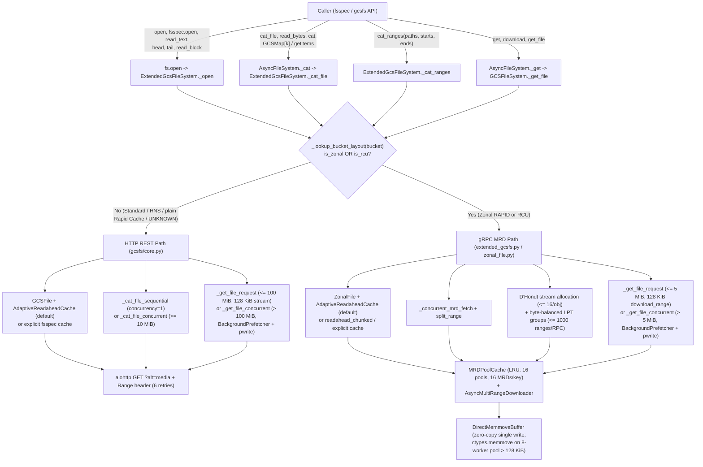

# Design: `gcsfs` Read Architecture Baseline

## Context

See `proposal.md` for motivation and scope.

Users read objects from Google Cloud Storage through `fsspec` using four distinct API families: buffered file handles (`open`, `fsspec.open`, `read_text`, `head`, `tail`, `read_block`), direct in-memory byte reads (`cat`, `cat_file`, `cat_ranges`, `read_bytes`), key-value mappings (`get_mapper`, `GCSMap`), and local disk downloads (`get`, `get_file`, `download`). Beneath that unified `fsspec` surface, `gcsfs` must serve three GCS bucket storage/cache topologies with very different performance and semantic profiles:

- Standard flat and Hierarchical Namespace (HNS) buckets, served over HTTP/REST (`aiohttp`) at `{location}/download/storage/v1/b/{bucket}/o/{object}?alt=media`.
- Zonal buckets (`StorageClass.RAPID`), which use appendable, potentially unfinalized objects and achieve high throughput and low latency over gRPC bidirectional streams (`AsyncMultiRangeDownloader`).
- Rapid Cache Ultra (RCU) buckets (`CachingTier.RAPID_CACHE_ULTRA`), which use standard storage with a high-performance gRPC read path.

This design documents how the current read stack in `fsspec/gcsfs` (as of `main` commit `7ef337d` with `fsspec` `2026.9.0`) unifies these APIs, dispatches transports, schedules prefetching and concurrency, manages gRPC MRD streams, and avoids memory copy bottlenecks. For normative behavioral requirements, see the five specs under `openspec/specs/reads/`.

## Goals / Non-Goals

**Goals:**
- Explain the end-to-end architecture and call graphs across all four `fsspec` read API families and both HTTP and gRPC transports.
- Capture the rationale behind key design choices: import-time extended class binding, Storage Control layout detection, adaptive background prefetching, transport-specific concurrency thresholds, D'Hondt MRD stream allocation, MRD pool staleness handling, and `DirectMemmoveBuffer`.
- Document concrete invariants, thresholds, and known trade-offs so future optimizations (such as multi-stream managers or zero-copy readinto paths) can reason safely against the baseline.

**Non-Goals:**
- Specifying write, rename, delete, or metadata listing paths (except where metadata lookups like `_info` and `get_storage_layout` directly gate read routing or size resolution).
- Proposing new runtime changes to `fsspec/gcsfs`; this document captures the baseline implementation as built.

## System Architecture Overview

## Decisions

### 1. Import-Time Binding of `ExtendedGcsFileSystem` and Lazy Layout Detection
- **Decision**: At import time in `gcsfs/__init__.py`, bind `gcsfs.GCSFileSystem` to `ExtendedGcsFileSystem` whenever `GCSFS_EXPERIMENTAL_ZB_HNS_SUPPORT` is truthy (default `"true"`) and gRPC/Storage Control dependencies import cleanly. At runtime, lazily resolve each bucket's `BucketLayout` via `storage_control_v2.StorageControlAsyncClient.get_storage_layout` (30 s timeout), caching known layouts in `_storage_layout_cache` while never caching `BucketLayout.UNKNOWN`.
- **Rationale**: `fsspec.known_implementations` maps `"gcs"` and `"gs"` to `"gcsfs.GCSFileSystem"`. Binding at import time gives callers automatic Zonal, RCU, and HNS support without changing protocol strings or constructor signatures. Lazy per-bucket lookup avoids upfront RPC overhead for buckets never touched and allows a single `GCSFileSystem` instance to work across mixed Standard, HNS, Zonal, and RCU buckets simultaneously. Leaving `UNKNOWN` uncached ensures transient permission or network blips recover on subsequent calls while cleanly falling back to HTTP for emulators like `fake-gcs-server`.
- **Alternatives Considered**: Requiring users to instantiate a separate `ZonalGCSFileSystem` or passing a bucket-type flag manually. Rejected because ML and analytics frameworks (Dask, PyTorch, Ray, Pandas, Zarr) construct filesystems solely via `gs://` URLs through `fsspec`.

### 2. Unified Sync/Async Bridging with Telemetry Context Propagation
- **Decision**: Inherit from `fsspec.asyn.AsyncFileSystem` (which runs a global background `"fsspecIO"` event-loop thread when `asynchronous=False`) and wrap every async `_foo` method and sync `foo` counterpart via `mirror_gcs_methods` and `bind_gcs_sync_methods` in `gcsfs/telemetry/wrapper.py`, rather than relying solely on `fsspec.asyn.mirror_sync_methods`.
- **Rationale**: Standard `fsspec.asyn.sync` switches threads to `"fsspecIO"`, which would drop caller-thread `ContextVar` telemetry state. Wrapping sync entry points captures the caller framework context before dispatching onto `self.loop`, while binding wrappers onto `self.__dict__` preserves clean garbage collection after `fork()`. `open_async` remains unimplemented because `AbstractBufferedFile` and `GCSFile`/`ZonalFile` expose synchronous Python file semantics bridged internally to the loop.
- **Alternatives Considered**: Rewriting `GCSFile` as an async-only stream. Rejected because virtually all Python data libraries expect synchronous `io.RawIOBase`-compatible file objects from `fs.open()`.

### 3. Default `AdaptiveReadaheadCache` Wired Directly to `_async_fetch_range`
- **Decision**: Default `GCSFile` and `ZonalFile` to `cache_type="adaptive"` (when `USE_EXPERIMENTAL_ADAPTIVE_PREFETCHING` is truthy, default `"true"`), backed by `fsspec.prefetcher.BackgroundPrefetcher` (`concurrency=4`, `max_prefetch_size=256 MiB`, ramping up prefetch multiplier starting at `MIN_STREAKS_FOR_PREFETCHING = 3` sequential reads and pausing proactive prefetch when variable-sized reads average `> 64 MiB`). In `GCSFile.__init__`, rebind `prefetcher.producer.fetcher` directly to the coroutine `self._async_fetch_range` on `gcsfs.loop`.
- **Rationale**: By default `fsspec`'s `BackgroundPrefetcher` wraps a synchronous `_fetch_range` inside `asyncio.to_thread`, which bounces back onto `gcsfs.loop` via `asyn.sync` and loses `split_factor` granularity. Rewiring `producer.fetcher` directly to `_async_fetch_range` eliminates thread-hop overhead and lets `GCSFile` dispatch directly into `_cat_file_concurrent(..., concurrency=split_factor)` and `ZonalFile` dispatch directly into `_concurrent_mrd_fetch(..., self.mrd_pool)` with zero extra `_info` or limit-parsing overhead.
- **Alternatives Considered**: Keeping `ReadAheadCache` (`"readahead"`) as default or relying on `ReadAheadChunked` (`"readahead_chunked"`). Plain `"readahead"` stalls between sequential blocks (no background pipelining), and `"readahead_chunked"` only works with vector fetchers (`ZonalFile._fetch_range_split`). Both remain available via explicit `cache_type`.

### 4. Asymmetric Concurrency Defaults and Range-Splitting Thresholds
- **Decision**:
  - `cat_file` / `read_bytes` default to `concurrency=1` (sequential). When `concurrency > 1`, `split_range(length, concurrency, MIN_CHUNK_SIZE_FOR_CONCURRENCY=5 MiB)` computes `num_chunks = min(concurrency, length // 5 MiB)`, meaning multi-chunk splitting activates only at `length >= 10 MiB`.
  - `get_file` defaults to `concurrency=4`, `chunk_size=16 MiB`, `max_prefetch_size=128 MiB`, but `_get_file_concurrent` downgrades to sequential 128 KiB streaming (`_get_file_request`) whenever `total_size <= max(5 MiB, _get_threshold_for_disk_reads(bucket))`, where the disk threshold is **`100 MiB`** for HTTP and **`5 MiB`** for gRPC/Zonal/RCU.
- **Rationale**: On HTTP, concurrent downloads incur extra `_info` metadata RPCs, multiple TCP/TLS handshakes, and pre-allocation (`f.truncate`) + `os.pwrite` threadpool overhead; below `100 MiB`, a single streaming HTTP `GET` into sequential disk writes is faster and cheaper. On gRPC/Zonal/RCU, multiplexed MRD streams and `DirectMemmoveBuffer` amortize parallel reads much earlier, so concurrent disk downloads pay off starting above `5 MiB`. Meanwhile, keeping `cat_file` at `concurrency=1` avoids multiplying RPCs when callers invoke `cat` or `cat_ranges` across hundreds of small objects concurrently.
- **Alternatives Considered**: Using a single uniform threshold across HTTP and gRPC, or defaulting `cat_file` to `concurrency=4`. Rejected because `cat()` already parallelizes across files (`batch_size=1280`), so inner fan-out on small files causes connection exhaustion and tail-latency regressions.

### 5. Batched Per-Object MRD Streams for `cat_ranges` with D'Hondt Apportionment
- **Decision**: In `ExtendedGcsFileSystem._cat_ranges`, when `max_gap is None` and at least one path targets a Zonal or RCU bucket:
  1. Group requested indices by object path and separate gRPC objects from HTTP objects.
  2. Allocate streams across gRPC objects using D'Hondt apportionment (`_allocate_streams`, minimum 1 stream per object, capped at `concurrency` or `MAX_ZONAL_STREAMS_PER_OBJECT = 16`).
  3. Balance each object's non-empty ranges across its assigned streams by byte size using a longest-processing-time-first heap (`_split_ranges_across_streams`), sorting each group by offset and chunking each `mrd.download_ranges` call to `MRD_MAX_RANGES = 1000`.
  4. Bound all gRPC stream coroutines and mixed HTTP `_cat_file` coroutines under a single `asyncio.Semaphore(batch_size)` and shield pool cleanup on cancellation.
- **Rationale**: `fsspec.asyn.AsyncFileSystem._cat_ranges` issues one `_cat_file` call per `(path, start, end)` tuple, which on Zonal/RCU would repeatedly check out pools and miss MRD's native multi-range batching. Grouping per object lets one `MRDPool` service thousands of Parquet/Zarr byte ranges in a handful of batched gRPC RPCs while preventing any single heavily-sliced object from starving other objects in the same batch.
- **Alternatives Considered**: Opening one MRD per range or coalescing gaps client-side when `max_gap is not None`. Per-range MRDs exhaust gRPC streams and incur handshake latency per slice; explicit `max_gap` is delegated to `super()._cat_ranges` to preserve `fsspec` contract parity.

### 6. `MRDPoolCache` Staleness Rules for Finalized vs. Unfinalized Zonal Objects
- **Decision**: Key `MRDPoolCache` by `(bucket_name, object_name, generation, cache_type)` (`max_idle_pools=16`, `max_queue_size=16`, LRU eviction on zero-refcount keys). During `MRDPool.initialize()`:
  - Check `finalized = info.get("timeFinalized") is not None`.
  - If **finalized**, reuse an idle cached MRD only if `mrd.persisted_size >= info["size"]`; otherwise park the stale MRD in `_stale_mrds` for closure and open a fresh MRD.
  - If **unfinalized**, always open a fresh MRD to obtain the latest server-reported `persisted_size`, and in `_get_file_concurrent` downgrade `"md5"`/`"crc32c"` consistency to `"size"` whenever `persisted_size != details["size"]`.
  - Create additional MRDs lazily up to `pool_size` outside `self._cond` (allowing parallel handshakes), and round-robin share active MRDs via lock-free `_inflight` counters once `pool_size` is reached.
- **Rationale**: Zonal objects can grow via appends while sharing the same generation before finalization. Reusing an old MRD stream caches an outdated `persisted_size`, causing truncated reads or false EOFs. Parking stale MRDs instead of closing them inline keeps acquisition non-blocking, and round-robin sharing prevents deadlocks when concurrent tasks outnumber `pool_size`.
- **Alternatives Considered**: Disabling MRD pooling entirely or caching MRDs without size checks. Disabling pooling adds prohibitive per-read gRPC stream setup latency for small random reads; caching without staleness checks corrupts reads on appended objects.

### 7. `DirectMemmoveBuffer` for High-Throughput gRPC Byte Assembly
- **Decision**: Assemble MRD range downloads in `_concurrent_mrd_fetch` and `_download_range_group` using `DirectMemmoveBuffer` + `PartialView` (`gcsfs/zb_hns_utils.py`):
  - Single write covering `[0, expected_size)` takes a zero-copy fast path (retains the incoming `bytes` object directly).
  - Multi-write buffers on CPython pre-allocate an uninitialized `bytes` object via `PyBytes_FromStringAndSize(None, expected_size)` (falling back to `bytearray` on non-CPython) and copy chunks via `ctypes.memmove` — inline when `<= 128 KiB`, or dispatched to an 8-worker `ThreadPoolExecutor` (`_memmove_executor`) with backpressure `Semaphore(max_pending=5)` when `> 128 KiB`.
  - Every `PartialView.close()` and `DirectMemmoveBuffer.get_value()` verifies exact byte count and raises `BufferError` on underfill.
- **Rationale**: Concatenating dozens of multi-megabyte gRPC chunks via `BytesIO` + `b"".join(...)` doubles peak RSS and holds the Python GIL during memory copies on the event-loop thread. Direct pre-allocation with off-loop `ctypes.memmove` eliminates intermediate copies while `BufferError` guarantees uninitialized memory is never leaked on truncated/failed streams.
- **Alternatives Considered**: `bytearray` + `bytes(buf)` conversion (incurs a full final copy) or `BytesIO` per range (used only in sequential 128 KiB `_get_file_request`, where chunks are small and written straight to disk).

## Risks / Trade-offs

- **[Risk] `readinto()` still incurs a copy in `AbstractBufferedFile`** → Neither `GCSFile` nor `ZonalFile` overrides `_fetch_range_into`; `AbstractBufferedFile.readinto` delegates to `self.read()` and copies into the target `memoryview`. Callers expecting zero-copy fills into pre-allocated tensor buffers pay one extra memcpy until a native `readinto` fast path is added.
- **[Risk] Consistency checksums are not verified on `cat_file` / `open` reads** → `GCSFileSystem.consistency` (`"md5"`, `"crc32c"`, `"size"`) is enforced only in `_get_file_request` and `_get_file_concurrent`. In-memory reads rely on transport-level integrity (TLS / gRPC) and MRD `BufferError` length validation.
- **[Risk] `GCSFile._fetch_range` does not pass `generation=self.generation` explicitly** → For HTTP `GCSFile`, pinned generations work when encoded in `path` with `version_aware=True` (parsed by `url()`), whereas an explicit `generation=` kwarg passed to `open()` without encoding in `path` is used in `details` (`info`) but not forwarded by `_fetch_range` to `cat_file`.
- **[Risk] `cat_ranges` with non-None `max_gap` raises `NotImplementedError`** → `ExtendedGcsFileSystem._cat_ranges` delegates `max_gap is not None` to `fsspec.asyn.AsyncFileSystem._cat_ranges`, which currently raises `NotImplementedError`. Callers requiring gap coalescing must coalesce ranges before calling `cat_ranges`.
- **[Risk] `readahead_chunked` cache is incompatible with HTTP `GCSFile`** → `ReadAheadChunked` passes `chunk_lengths=` to `self.fetcher`, which is implemented only on `ZonalFile._fetch_range` and raises `TypeError` if selected on a Standard/HNS `GCSFile`.
- **[Risk] Background teardown during interpreter shutdown or loop-thread `close()`** → `GCSFile._close_impl` and `ZonalFile._close_impl` defer teardown to daemon threads (`gcsfs-deferred-close` / `sync_teardown`) and skip async cleanup when `sys.is_finalizing()` is true, trading strict finalizer determinism for deadlock avoidance.

## Open Questions

None. This design captures the verified baseline behavior of `fsspec/gcsfs` at commit `7ef337d`; future modifications to any read path should be authored as new OpenSpec changes targeting the `openspec/specs/reads/*` capabilities.
