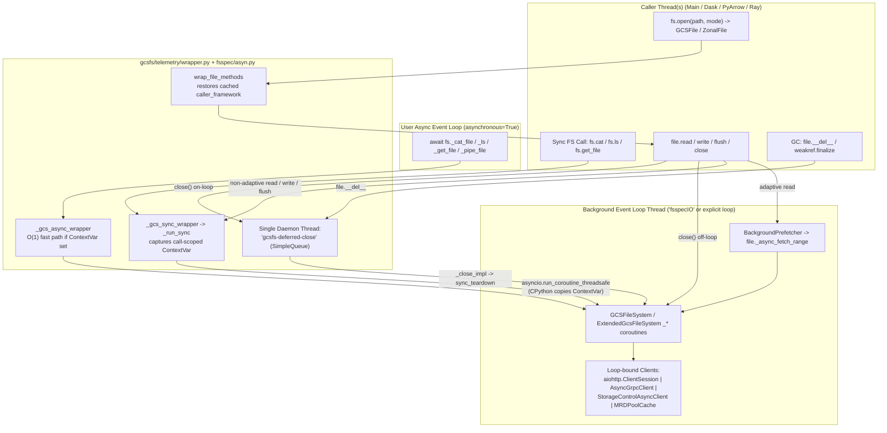

# Design: Sync & Async Filesystem and File Runtime Architecture

## Context

See `proposal.md` for motivation and scope.

`gcsfs` is built on `fsspec.asyn.AsyncFileSystem` (`async_impl = True`, `mirror_sync_methods = True`), with two filesystem tiers (`GCSFileSystem` in `gcsfs/core.py` and `ExtendedGcsFileSystem` in `gcsfs/extended_gcsfs.py`) and two buffered file handle tiers (`GCSFile` in `gcsfs/core.py` and `ZonalFile` in `gcsfs/zonal_file.py`).

Internally, every I/O primitive is asynchronous (`aiohttp.ClientSession` for HTTP REST, `AsyncGrpcClient` / `AsyncMultiRangeDownloader` / `AsyncAppendableObjectWriter` for Zonal and RCU gRPC data paths, and `StorageControlAsyncClient` for HNS/layout control plane). Externally, callers interact with `gcsfs` in two distinct modes:

1. **Synchronous mode (`asynchronous=False`, default)**: Callers invoke public sync filesystem methods (`fs.cat`, `fs.ls`, `fs.get_file`, `fs.open`, etc.) and synchronous `io`-compatible file handles (`GCSFile`, `ZonalFile`) from arbitrary application threads. Operations bridge onto a background `asyncio` event loop thread (`"fsspecIO"`, or a caller-provided `loop`).
2. **Native asynchronous mode (`asynchronous=True`)**: Callers `await` `_`-prefixed coroutine methods (`await fs._cat_file(...)`, `await fs._ls(...)`, `await fs._get_file(...)`, etc.) directly inside their own running `asyncio` event loop.

This design documents the complete baseline sync/async execution model, bridging layers, teardown state machines, and known hazards as built on `main` (`7ef337d`) with `fsspec` `2026.9.0`. For normative requirements, see `openspec/specs/runtime/sync-async-lifecycle/spec.md`.

## Goals / Non-Goals

**Goals:**
- Map the exact execution lifecycle of sync (`asynchronous=False`) and async (`asynchronous=True`) filesystem instances and file handles (`GCSFile` / `ZonalFile`).
- Explain how `mirror_gcs_methods`, `bind_gcs_sync_methods`, `wrap_file_methods`, and `fsspec.asyn.sync` interact without breaking `mock.patch`, MRO `super()`, telemetry `ContextVar` isolation, or `subprocess.Popen(..., preexec_fn=...)` forks.
- Document the multi-stage file/client teardown protocols (`_defer_close`, `sync_teardown`, `_defer_task`, `_close_resources`, `close_session`, `_finalize_mrd_pool_cache`) and their thread/loop invariants.
- Surface concrete failure modes and gaps in the current implementation so future changes can target them explicitly.

**Non-Goals:**
- Designing a new public `open_async` / `AbstractAsyncStreamedFile` implementation or fixing existing session-teardown/fork bugs in this baseline document (those belong in dedicated follow-up OpenSpec changes).

## Runtime Architecture Overview

## Decisions

### 1. Import-Time Class Mirroring (`mirror_gcs_methods`) Instead of Per-Instance `fsspec.asyn.mirror_sync_methods`
- **Decision**: At class-definition time (`GCSFileSystem` and `ExtendedGcsFileSystem`), `mirror_gcs_methods(cls)` (`gcsfs/telemetry/wrapper.py`) wraps all eligible single-underscore `_foo` coroutines and async generators with `_gcs_async_wrapper`, generates class-level `_gcs_sync_wrapper` methods for every public sync counterpart, and stores the list of mirrored names in `cls._gcs_sync_method_names`.
- **Rationale**:
  - `fsspec.asyn.sync_wrapper` closes directly over the function object and does not capture/propagate `gcsfs` telemetry `ContextVar` state across the `run_coroutine_threadsafe` boundary.
  - `_gcs_sync_wrapper` resolves `getattr(self, func.__name__)` dynamically on each call, so subclass overrides and runtime monkeypatches on `_foo` are respected through base sync wrappers.
  - When wrapping inherited `AsyncFileSystem._foo` methods onto `GCSFileSystem`, `_gcs_async_wrapper` passes `super_cls=GCSFileSystem` so it dispatches via `getattr(super(GCSFileSystem, self), name)` instead of mutating `AsyncFileSystem` or breaking `mock.patch("fsspec.asyn.AsyncFileSystem._cat_ranges", ...)`.
  - When `_Cached.__call__` (`fsspec/spec.py`) later invokes `fsspec.asyn.mirror_sync_methods(obj)`, it checks whether `obj.foo.__func__ is AbstractFileSystem.foo`. Because `mirror_gcs_methods` already replaced `foo` on the class, `fsspec`'s mirroring becomes a clean no-op.
- **Alternatives Considered**: Overriding `fsspec.asyn.sync` globally or monkeypatching `AsyncFileSystem`. Rejected because global mutation affects unrelated `fsspec` filesystems in the same process (e.g., `s3fs`, `adlfs`).

### 2. Instance Binding (`bind_gcs_sync_methods`) for `fork()` + `preexec_fn` Safety
- **Decision**: At the end of `GCSFileSystem.__init__`, `bind_gcs_sync_methods(self)` binds each `_gcs_sync_wrapped` function from `type(self)._gcs_sync_method_names` into `self.__dict__` via `types.MethodType(method, self)` (strictly checking `getattr(method, "_is_gcs_sync_wrapped", False) is True` so class-patched mocks are skipped).
- **Rationale**: Storing bound methods in `self.__dict__` intentionally creates a `self -> __dict__ -> MethodType -> __self__ (self)` reference cycle, matching the historical side effect of `fsspec.asyn.mirror_sync_methods`. During `subprocess.Popen(..., preexec_fn=...)` (used by `ray.init()`), Python forks with cyclic GC temporarily disabled and runs `fsspec.spec._reset_instances_lock` (`after_in_child`), which calls `cls._cache.clear()`. Without this cycle, cached-only `ExtendedGcsFileSystem` instances would reach refcount 0 immediately in the child, invoking finalizers and deallocating inherited `grpc.aio` channels before `execve`, which deadlocks or crashes the child. With the cycle, deallocation is deferred past `execve` while cyclic GC in the parent still collects unreferenced instances normally.
- **Alternatives Considered**: Adding an `os.register_at_fork` hook to leak cached instances in children permanently. Rejected because keeping standard `fsspec` `_Cached` cycle semantics works seamlessly with `clear_instance_cache()` + `gc.collect()` in parent processes and existing tests.

### 3. Single Event-Loop Affinity and Dual-Mode Scoping (`asynchronous=False` vs `True`)
- **Decision**: Inherit `AsyncFileSystem.__init__`, which sets:
  - `asynchronous=False`: `self._loop = loop or fsspec.asyn.get_loop()` (the shared process-wide `"fsspecIO"` daemon thread), cached process-wide in `_Cached._cache` keyed by `(cls, pid, ...)`.
  - `asynchronous=True`: `self._loop = None` (even if a `loop=` argument was passed), cached per thread in `_Cached._cache` keyed by `(cls, pid, thread_id, ...)`.
  - All async clients (`_session`, `_grpc_client`, `_storage_control_client`, `_mrd_pool_cache`) are created lazily on whichever event loop awaits them first.
- **Rationale**: `aiohttp.ClientSession`, `grpc.aio` channels, and `asyncio.Queue`/`Lock`/`Condition` primitives are strictly affine to the event loop that created them. Separating `asynchronous=False` (dedicated `"fsspecIO"` loop) from `asynchronous=True` (caller's running loop) lets sync users ignore asyncio completely while allowing native async callers to run without thread-hops.
- **Alternatives Considered**: Supporting mixed sync and async calls on the same instance across two different loops. Rejected because `aiohttp` and `grpc.aio` transports cannot safely straddle two concurrent event loops.

### 4. Synchronous File Handles with Native-Async Prefetcher Fast Path (`GCSFile` & `ZonalFile`)
- **Decision**:
  - `fs.open()` / `fs._open()` always returns a synchronous `AbstractBufferedFile` subclass (`GCSFile` or `ZonalFile`), while `open_async` remains unimplemented (`NotImplementedError`).
  - Both file classes capture `self.caller_framework` once in `__init__` and apply `wrap_file_methods(cls)` at import time so every method and property restores `Dimension.FRAMEWORK` in `ContextVar` even when executed on worker threads, `BackgroundPrefetcher`, or `"gcsfs-deferred-close"`.
  - For `cache_type="adaptive"` (default), `GCSFile.__init__` rebinds `BackgroundPrefetcher` onto `gcsfs.loop` if `fsspec`'s global loop differs (e.g., explicit `loop=` or after `reset_lock()`), swaps `prefetcher.producer.fetcher` to the native coroutine `self._async_fetch_range` (avoiding `asyncio.to_thread` -> `asyn.sync` round-trips), and disarms `cache.close = lambda: None` so teardown is controlled solely by `_close_impl()`.
  - Non-adaptive reads (`_fetch_range`) and writes (`write`, `flush`, `commit`, `_initiate_upload`, `_upload_chunk`) bridge to `fs.loop` via `asyn.sync` / `fs.call` / `fs.cat_file`.
- **Rationale**: Python data ecosystems (Arrow, Parquet, Pandas, PyTorch, HuggingFace) require synchronous file-like objects, yet high-throughput streaming needs native-async pipelining on `fs.loop` without GIL-bouncing through worker threads.
- **Alternatives Considered**: Leaving `BackgroundPrefetcher` calling `asyncio.to_thread(self._fetch_range)`. Rejected because it wastes threads and loses direct `split_factor` control into `_cat_file_concurrent` and `_concurrent_mrd_fetch`.

### 5. Three-Path Deadlock-Free File Teardown (`_defer_close`, `sync_teardown`, `handoff_lock`)
- **Decision**:
  1. **Bounded deferred close worker (`gcsfs/core.py`)**: Maintain a single module-level daemon thread `"gcsfs-deferred-close"` draining a `queue.SimpleQueue` (`_deferred_close_queue`). Both `GCSFile.__del__` (always) and `GCSFile.close()` (whenever `_on_loop_thread(self.gcsfs.loop)` is True) mark `self._close_deferred = True` and enqueue `file._close_impl()` rather than blocking the GC thread or deadlocking the event loop thread.
  2. **Loop-aware `sync_teardown` (`gcsfs/zb_hns_utils.py`, mirrored in `fsspec/asyn.py`)**: Off-loop calls run `asyncio.run_coroutine_threadsafe(coro, loop)` and wait up to `timeout` (default `60.0 s` for MRD/AAOW; `10.0 s` for `BackgroundPrefetcher`), raising `FSTimeoutError` without cancelling the background teardown. On-loop calls schedule via `_defer_task` (retaining a strong ref in `_deferred_close_tasks` until done and logging errors). Finalizing interpreter calls close the coroutine and return immediately.
  3. **Independent multi-stage close (`ZonalFile._close_impl`)**: Executes (a) `super()._close_impl()` (prefetcher + AAOW flush/dircache), (b) `mrd_pool.close()`, and (c) `close_aaow(...)` independently, collecting exceptions into `errors` and re-raising `errors[0]` after all stages run.
  4. **Interrupted constructor handoff (`ZonalFile.__init__`)**: Coordinates `_checkout_pool` on `fs.loop` with caller-thread `BaseException` via `handoff_lock` + `handoff["aborted"]` because `fsspec.asyn.sync` does not cancel in-flight coroutines on `KeyboardInterrupt`.
- **Rationale**: Closing a file synchronously from inside `fs.loop` (for example when GC runs during a coroutine step on `"fsspecIO"`) calls `asyn.sync(self.loop, ...)`, which would immediately raise `NotImplementedError` or deadlock. A single bounded worker prevents unbounded thread spawning during bulk GC bursts (e.g., 64+ files collected at once), while `handoff_lock` prevents MRD pool leaks on Ctrl-C during open.
- **Alternatives Considered**: Spawning a new `threading.Thread` per deferred close (risks thread exhaustion under GC bursts) or letting `AdaptiveReadaheadCache.__del__` run `sync_teardown` directly (risks blocking GC thread on arbitrary locks).

### 6. Client & Pool Teardown Ordering (`_close_resources` vs. Weakref Finalizers)
- **Decision**:
  - `GCSFileSystem._set_session()` registers `weakref.finalize(self, self.close_session, self.loop, self._session, self.asynchronous)`.
  - `ExtendedGcsFileSystem.__init__` registers `weakref.finalize(self, self._memmove_executor.shutdown)` and `weakref.finalize(self, self._finalize_mrd_pool_cache, self.loop, self._mrd_pool_cache)`.
  - Explicit async cleanup is provided via private `await fs._close_resources()`, which closes resources in strict dependency order: (1) `await self._mrd_pool_cache.close()` (drains open MRD streams), (2) `await self._storage_control_client.transport.close()`, (3) `await self._grpc_client.grpc_client.transport.close()`.
- **Rationale**: Closing the underlying `grpc.aio` channel before closing active `AsyncMultiRangeDownloader` streams produces gRPC channel-closed errors and hangs; draining `_mrd_pool_cache` first guarantees clean stream shutdown.

## Risks / Trade-offs

- **[Risk] `GCSFileSystem.close_session` uses non-thread-safe `loop.create_task()` from GC threads and can misroute `asynchronous=True` sessions** → In `gcsfs/core.py`, `close_session` calls `loop.create_task(session.close())` directly when `loop` is running (even from the GC thread rather than `loop.call_soon_threadsafe` / `run_coroutine_threadsafe`), holds no strong reference to the task, lacks a `sys.is_finalizing()` guard, and falls back to `asyn.loop[0]` even for `asynchronous=True` instances whose session belongs to a user loop. **Mitigation**: Test fixtures and long-running services should explicitly close sessions on the owning loop (`await fs._session.close()`) before loop shutdown; a follow-up change should replace `close_session` with `sync_teardown`/thread-safe scheduling.
- **[Risk] No public `close()` / `aclose()` API on `GCSFileSystem` / `ExtendedGcsFileSystem` and missing gRPC transport finalizers** → `_close_resources()` is private, omits `_session` and `_memmove_executor`, and neither `_grpc_client` nor `_storage_control_client` has a `weakref.finalize`. **Mitigation**: Callers managing short-lived `asynchronous=True` loops should call `await fs._close_resources()` and close `fs._session` explicitly before the loop closes.
- **[Risk] `_Cached` keys `asynchronous=True` instances by `thread_id`, not by event loop** → Two sequential `asyncio.run()` calls on the same thread reuse a cached `GCSFileSystem(asynchronous=True)` whose `_session` and gRPC clients are bound to the first (now closed) event loop. **Mitigation**: Pass `skip_instance_cache=True` or call `GCSFileSystem.clear_instance_cache()` between distinct `asyncio.run()` invocations on the same thread.
- **[Risk] `GCSFileSystem(asynchronous=True)` still starts `"fsspecIO"` via telemetry warm-up and cannot use `fs.open()`** → `telemetry_manager.default_usage_tracker.warm_up()` calls `fsspec.asyn.get_loop()` on GCE/GKE, and `open()` / `GCSFile` / `ZonalFile` require a non-None `fs.loop`, while `open_async` raises `NotImplementedError`. **Mitigation**: Async-only callers use `_cat_file`, `_cat_ranges`, `_get_file`, `_pipe_file`, `_put_file`, `_ls`, `_info`, etc.
- **[Risk] Long-lived `fork()` children (not `fork` + `exec`) remain unsafe** → `bind_gcs_sync_methods` only shields `subprocess.Popen(..., preexec_fn=...)` while cyclic GC is disabled. Additionally, `core._deferred_close_queue`/`_deferred_close_lock`, `zb_hns_utils._deferred_close_lock`, `GoogleCredentials.lock`, and `fsspec.asyn._lock` (due to an upstream `global lock` typo in `fsspec.asyn.reset_after_fork`) are not reset in forked children, and inherited `grpc.aio` channels deadlock on fork. **Mitigation**: Multiprocessing workloads (PyTorch `DataLoader`, Ray workers) MUST use `"spawn"` or `"forkserver"` start methods.
- **[Risk] Synchronous credential refresh blocks the event loop thread** → `GoogleCredentials.apply()` → `maybe_refresh()` performs synchronous `requests.Session()` I/O under a `threading.Lock` inside `async def _request` and `_get_file_request`. **Mitigation**: Token refreshes are infrequent (~once per hour with `LOCAL_REFRESH_BUFFER = 300 s`), though high-concurrency event loops experience a brief stall during refresh.
- **[Risk] `fsspec.asyn._runner` turns `asyncio.CancelledError` into `None` and does not cancel on caller timeout/`KeyboardInterrupt`** → Upstream `fsspec/asyn.py` catches `except Exception:` (not `BaseException`), so a cancelled task returns `None` to `sync()`, and caller interruption leaves the loop coroutine running. **Mitigation**: Critical resource acquisitions (like `ZonalFile._checkout_pool`) use explicit `handoff_lock` guards to clean up orphaned results.

## Open Questions

None. This design documents the verified baseline runtime behavior of `fsspec/gcsfs` at commit `7ef337d`; any fixes to the identified teardown, fork, or `open_async` gaps should be proposed as new OpenSpec changes modifying `openspec/specs/runtime/sync-async-lifecycle/spec.md`.
